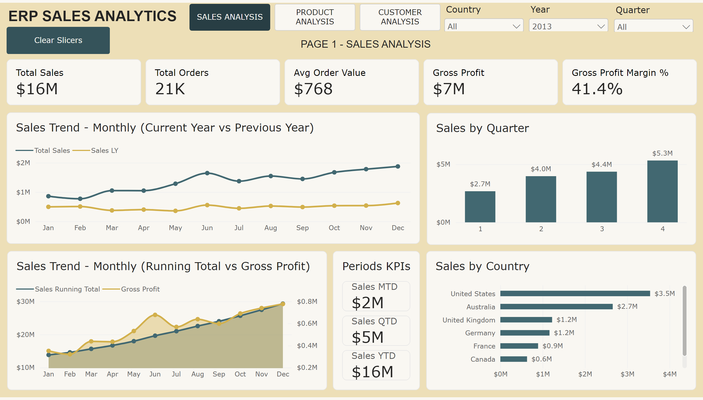
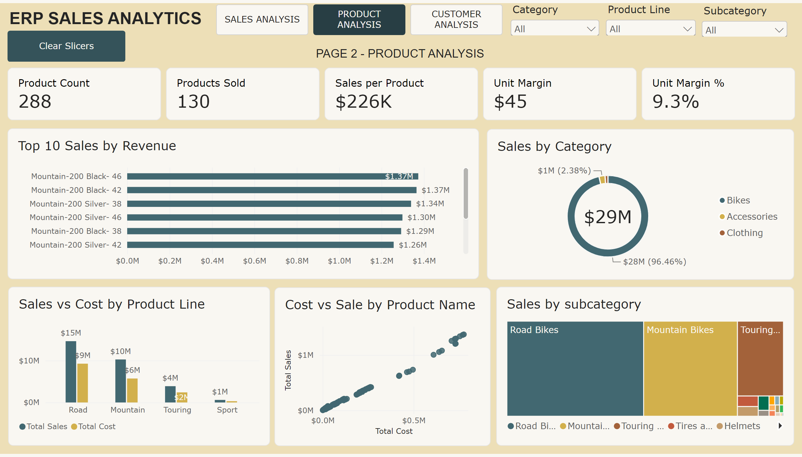
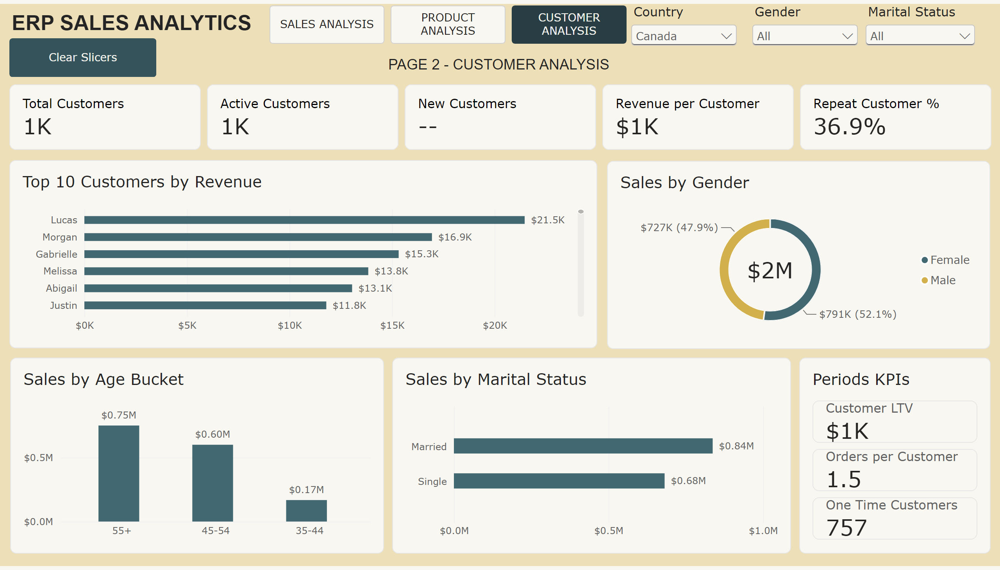

# ERP Data Analytics Dashboard — Power BI

A comprehensive Power BI solution built on the **AdventureWorksDW** ERP dataset, delivering end-to-end sales, product, and customer analytics with enterprise-grade Dynamic Row Level Security (RLS).

---

## Project Structure

```
ERP Sales_Projects/
├── ERP_Data_Analytics_Dashboard.pbip          # Power BI Project entry point
├── ERP_Data_Analytics_Dashboard.Report/       # Report layer (pages, visuals, themes)
│   └── definition/pages/
│       ├── salesanalysispage001/              # Sales Analysis page
│       ├── productanalysispage02/             # Product Analysis page
│       └── customeranalysis003/               # Customer Analysis page
├── ERP_Data_Analytics_Dashboard.SemanticModel/ # Data model layer
│   └── definition/
│       ├── tables/                            # Dimension & fact table definitions
│       ├── roles/                             # Dynamic RLS role
│       ├── relationships.tmdl                 # All table relationships
│       └── expressions.tmdl                  # Power Query / M expressions
├── AdventureWorksDW2025.bak                   # Source SQL Server backup
└── ERP_Data_Analytics_Dashboard.pptx          # Presentation deck
```

---

## Data Model

### Tables

| Table | Type | Description |
|---|---|---|
| `fact_sale` | Fact | Core sales transactions (sales_amount, quantity, price, order/ship/due dates) |
| `dim_customers` | Dimension (SCD2) | Customer master with demographics, geography, lifecycle dates |
| `dim_products` | Dimension (SCD2) | Product catalog with category, subcategory, cost, product line |
| `dim_dates` | Dimension | Date table supporting order, ship, and due date role-playing |
| `dim_securities` | Security | User-to-region mapping table for Dynamic RLS |
| `_Measures` | Measures Table | All DAX measures centralized in one table |

### Relationships

- `fact_sale[customer_id]` → `dim_customers[customer_id]` (active)
- `fact_sale[product_id]` → `dim_products[product_id]` (active)
- `fact_sale[order_date]` → `dim_dates[full_date]` (active)
- `fact_sale[ship_date]` → `dim_dates[full_date]` (inactive — activated via `USERELATIONSHIP`)
- `fact_sale[due_date]` → `dim_dates[full_date]` (inactive — activated via `USERELATIONSHIP`)
- `dim_customers[country]` → `dim_securities[region]` (RLS filter propagation)

---

## Report Pages

### 1. Sales Analysis
KPI cards, trend lines, YoY/MoM comparisons, MTD/QTD/YTD accumulators, weekday vs weekend split, and running total visuals.



### 2. Product Analysis
Category/subcategory breakdown, product ranking, margin analysis, active vs inactive product counts, and sales-per-product metrics.



### 3. Customer Analysis
Customer segmentation by age bucket, gender, marital status, geography, repeat vs one-time buyers, LTV, and revenue-per-customer trends.



---

## DAX Measures (44 total)

| Category | Measures |
|---|---|
| Core Sales | Total Sales, Total Quantity, Total Orders, Total Cost |
| Profitability | Gross Profit, Gross Profit Margin %, Unit Margin, Unit Margin % |
| Time Intelligence | Sales LY, Sales YoY %, Sales MTD, Sales QTD, Sales YTD, Sales YTD LY, Sales LM, Sales MoM %, Sales Running Total |
| Date Role-Playing | Sales by Ship Date, Sales by Due Date |
| Calendar | Sales Weekday, Sales Weekend |
| Product | Category Rank, Product Count, Active Product Count, Products Sold, Sales per Product, Sales % of Total |
| Customer | Total Customers, Active Customers, New Customers, Repeat Customers, One Time Customers, Repeat Customer %, Revenue per Customer, Orders per Customer, Customer Rank, Customer LTV |
| Demographics | Sales Male, Sales Female, Sales Married, Sales Single |
| Pricing | Avg Order Value, Avg Selling Price |

---

## Dynamic Row Level Security (RLS)

Security is enforced via the `Dynamic RLS` role using the `dim_securities` table.

**How it works:**
1. `dim_securities` maps each `user_email` to one or more `region` values
2. The RLS role filters `dim_customers[country]` to only regions allowed for the logged-in user
3. The filter propagates through relationships to `fact_sale`, restricting all visuals automatically

**DAX filter on `dim_customers`:**
```dax
VAR CurrentEmail = LOWER(USERPRINCIPALNAME())
VAR AllowedRegions =
    CALCULATETABLE(
        VALUES(dim_securities[Region]),
        FILTER(ALL(dim_securities), LOWER(dim_securities[user_email]) = CurrentEmail)
    )
RETURN
    dim_customers[country] IN AllowedRegions
```

---

## Tech Stack

- Power BI Desktop (PBIP format)
- DAX (Data Analysis Expressions)
- Power Query / M Language
- SQL Server (AdventureWorksDW2025 source)
- Fluent2 / Frontier themes

---

## How to Open

1. Install **Power BI Desktop** (latest version)
2. Restore `AdventureWorksDW2025.bak` to a SQL Server instance
3. Open `ERP_Data_Analytics_Dashboard.pbip`
4. Update the data source connection in **Transform Data → Data Source Settings**
5. Refresh the model
